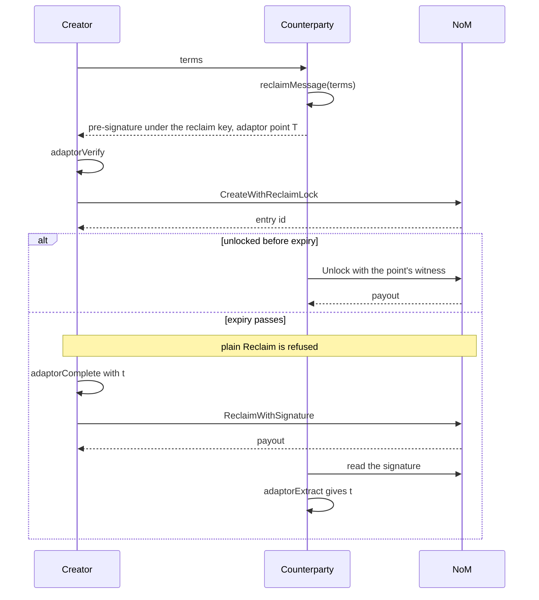

# PTLC

Client support for the `ptlc` embedded contract in go-zenon `dev`
(`z1qxemdeddedxptlcxxxxxxxxxxxxxxxxx6lqady`, spork
`e59f1e97f1096a18c2bc8421345b2633b11b839adb153e96dc65034c95f83f8d`), checked
against dev at `ac16bfd`, which includes the reclaim lock (go-zenon PR 216).

A PTLC locks an amount of any ZTS token to a point until an expiration time.
Whoever presents the witness for the point before then is paid; after it, the
creator takes the tokens back.

## Point types

| Type | Constant | Lock | Witness |
|---|---|---|---|
| 0 | `ptlcPointTypeEd25519` | 32-byte Ed25519 key, not of small order | Ed25519 signature over the unlock message |
| 1 | `ptlcPointTypeBip340` | 32-byte x-only BIP-340 key | BIP-340 signature over the unlock message |
| 2 | `ptlcPointTypeSecp256k1Point` | 33-byte compressed point | the 32-byte scalar behind the point |

A type 2 entry must name a destination: its witness is a bare scalar, so
whoever sees it first could otherwise claim it. A destination, when given,
must be a user address.

## API

`znnClient.embedded.ptlc`:

| Call | Contract method |
|---|---|
| `create(token, amount, expirationTime, pointType, pointLock, destination)` | `Create` |
| `createWithReclaimLock(..., reclaimPointType, reclaimPointLock)` | `CreateWithReclaimLock` |
| `unlock(id, witness)` | `Unlock` |
| `proxyUnlock(id, destination, witness)` | `ProxyUnlock` |
| `reclaim(id)` | `Reclaim` |
| `reclaimWithSignature(id, signature)` | `ReclaimWithSignature` |
| `getById(id)` | RPC `embedded.ptlc.getById` |
| `getReclaimLockById(id)` | RPC `embedded.ptlc.getReclaimLockById` |

Offline, on `PtlcApi`:

- `unlockMessage(chainIdentifier, pointType, id, destination)`: SHA3-256 of
  `"zenon-ptlc-unlock:v1" ‖ uint64be(chain) ‖ contract ‖ pointType ‖ id ‖ destination`.
- `verifyWitness(...)`: the contract's own unlock check.
- `reclaimMessage(chainIdentifier, reclaimPointType, timeLocked, destination, tokenStandard, amount, expirationTime, pointType, pointLock)`
  and `reclaimMessageOf(chainIdentifier, reclaimPointType, entry)`: SHA3-256 of
  `"zenon-ptlc-reclaim:v1" ‖ uint64be(chain) ‖ contract ‖ reclaimPointType ‖ creator ‖ destination ‖ token ‖ uint256be(amount) ‖ int64be(expiration) ‖ pointType ‖ pointLock`.
- `verifyReclaimSignature(chainIdentifier, entry, reclaimPointType, reclaimPointLock, signature)`:
  the contract's reclaim check, including the lock itself.

`Validations.ptlcPointLock`, `ptlcDestination`, `ptlcWitness`,
`ptlcReclaimLock` and `ptlcReclaimSignature` refuse what the contract refuses,
so a call is never published to be rejected.

`Bip340` and `Secp256k1` carry what a swap needs around the contract:
BIP-340 sign and verify, and single-signer adaptor signatures
(`adaptorSign`, `adaptorVerify`, `adaptorComplete`, `adaptorExtract`).

## Reclaim lock

An entry made with `createWithReclaimLock` is reclaimed only by
`reclaimWithSignature`, with a signature under the reclaim lock (an Ed25519 or
BIP-340 key) over the entry's reclaim message. Plain `reclaim` is refused for
it, and `reclaimWithSignature` is refused for an entry without one. An unlock
works as on any entry and removes the lock with it.

There is no fallback. A creator who does not hold a valid signature, or a
pre-signature they can complete, before sending the create can watch the
tokens be unlocked but never take them back. Check it with
`verifyReclaimSignature` or `Bip340.adaptorVerify` first.

The reclaim message binds the entry's terms, not its id, because the
counterparty signs before the entry exists and a wallet that signs and
publishes in one call cannot show the block hash first. One signature is
therefore valid for every entry with the same terms under the same lock: use a
fresh reclaim key for each swap.

In a swap the counterparty holds the reclaim key and hands the creator a
BIP-340 adaptor pre-signature. Reclaiming publishes the completed signature,
from which the counterparty extracts the creator's secret:



## Tests

`test/embedded/ptlc_test.dart` compares every Dart verdict with go-zenon's on
`test/fixtures/ptlc_vectors.json`: messages, lock and destination checks,
witnesses, reclaim locks, reclaim signatures, ABI encoding and the RPC's JSON.
It also carries go-zenon's own reclaim-message known answers.

The fixture is written by `tool/ptlc_vectors/ptlc_vectors_dump_test.go`, which
calls the contract's unexported checks and so runs inside go-zenon's
`vm/embedded/implementation` package:

```sh
cp tool/ptlc_vectors/ptlc_vectors_dump_test.go <go-zenon>/vm/embedded/implementation/
cd <go-zenon>
PTLC_VECTORS_OUT=$PWD/ptlc_vectors.json PTLC_VECTORS_SOURCE="zenon-network/go-zenon dev <commit>" \
  go test -run TestDumpPtlcVectors ./vm/embedded/implementation/
```

`test/embedded/ptlc_live_test.dart` runs every point type, proxy unlock, both
reclaim paths, refusals and expiry against a node with the spork active. Set
`PTLC_NODE` (a `ws://` URL) and `PTLC_MNEMONIC` (a funded account at
`PTLC_ACCOUNT_INDEX`, default 1); without them it is skipped.
